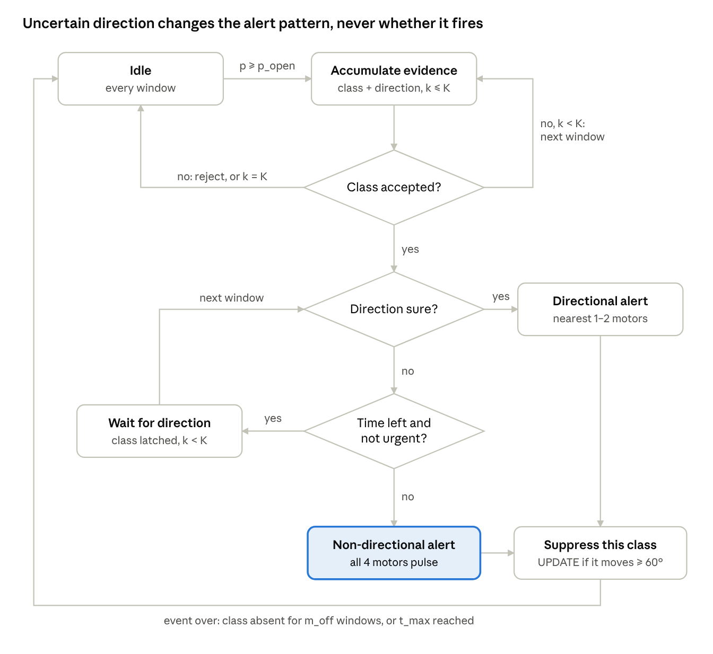

# SoundScape Band

**Reliability-aware directional haptic alerting for a low-cost, three-microphone wearable for Deaf and hard-of-hearing users.**

SoundScape Band is a sub-₹2,000 neckband that detects safety-critical sounds (vehicle horn, siren/alarm, shout, reversing beep) and tells the wearer *where* they come from through four vibration motors (front, right, back, left). This repository contains **DEDA (Dual-Evidence Deadline Alerting)**, the decision algorithm that turns the band's direction estimates and sound-class predictions into haptic alerts, together with its tests, simulations and evaluation scripts.



## The idea in one paragraph

Existing sound-alert wearables either give no direction, or show an angle without knowing whether it can be trusted. A wrong-direction vibration sends the wearer's attention away from the hazard. DEDA decides **what** a sound is and **where** it comes from with separate evidence. A direction is accepted only when three cheap geometric checks agree: the TDOA closure of the microphone triangle, the plane-wave norm, and the GCC-PHAT coherence computed on the strongest frequency bins. If the class is certain but the direction is not, the band still alerts within 300 ms on all four motors and sends a directional update once the direction settles. **An uncertain class can be rejected; an uncertain direction can never block an alert.**

## Status

| Component | Synthetic data | Recorded audio | On RP2040 / ESP32 |
|---|---|---|---|
| DEDA decision policy (Python + C) | ✅ tested | ⏳ not yet | ⏳ not yet |
| GCC-PHAT fractional-lag grid + reliability checks | ✅ tested (free field) | ⏳ not yet | ⏳ not yet |
| C core matches Python reference | ✅ exact (double), 94/94 alerts (float) | — | ⏳ not yet compiled for MCU |
| `evaluate_logs.py` (real-data comparison) | ✅ smoke-tested | ⏳ waiting for recordings | — |
| Firmware integration | — | — | ⏳ see [`firmware/`](firmware/) |

> **All results below come from simulation.** They check that the logic behaves as designed; they are not evidence of real-world performance. The recorded-data protocol is in [`docs/experiment_protocol.md`](docs/experiment_protocol.md).

## Key results (simulation)

Synthetic decision-level streams, 4 seeds × 20 min, operating points chosen on separate calibration streams (mean ± SD):

| Policy | Wrong-direction alerts (% of events) | Missed or late >300 ms (%) | Non-directional alerts (%) |
|---|---|---|---|
| B: fixed threshold + raw angle (original design) | 23.5 ± 4.3 | 15.8 ± 7.2 | 1.3 ± 1.5 |
| **DEDA** | **2.7 ± 2.1** | 17.3 ± 2.5 | 8.7 ± 9.7 |

Free-field direction front end, harmonic horn-like source at 0 dB SNR, 16 kHz: correct quadrant **64 % → 93 %** when GCC-PHAT uses only the strongest 25 % of bins.

The sequential confirmation of uncertain classes gave **no** measurable benefit in simulation. Full tables: [`results/`](results/) · trade-off curves: [`docs/figures/synthetic_tradeoff.png`](docs/figures/synthetic_tradeoff.png).

## Repository layout

```
python/deda/        reference implementation: policy.py (DEDA + baselines), doa.py (GCC-PHAT, checks), metrics.py, synth.py
python/tests/       31 unit and Python-vs-C equivalence tests
python/*.py         run_synthetic.py, acoustic_checks.py, evaluate_logs.py, make_demo_logs.py
c/                  embedded C99 core: deda.c/.h (decision policy), doa_gcc.c (GCC grid, direction maths), host test driver
firmware/           MCU integration notes and example
hardware/           bill of materials and wiring
docs/               algorithm specification, experiment protocol, figures
results/            outputs behind the numbers in the paper
data/               log format for recorded trials (recordings themselves are hosted externally)
```

## Quick start

Requires Python ≥ 3.10, a C compiler and `make`.

```bash
git clone https://github.com/<owner>/soundscape-band.git
cd soundscape-band
pip install -r requirements.txt

cd c && make && cd ..            # host builds of the C core (float and double)
cd python
python -m pytest -q tests        # 31 tests
python acoustic_checks.py        # free-field direction front-end checks (~10 s)
python run_synthetic.py          # policy comparison + ablations (~5 min) -> ../results/
```

### Evaluating on recorded trials

1. Log one row per analysis window from the band (CNN logits + TDOA outputs) in the format in [`data/README.md`](data/README.md).
2. Split recordings by **session and source clip** into `calib` and `test`.
3. Run:

```bash
python evaluate_logs.py windows.csv events.csv --target-miss 0.05 --out results.json
```

This fits the temperature, selects thresholds on the calibration split only, and reports baselines A, B and DEDA on the test split with session-level bootstrap confidence intervals. Try it on demo data with `python make_demo_logs.py` first.

## Using the C core

```c
#include "deda.h"

deda_config_t cfg; deda_default_config(&cfg);   /* replace thresholds with calibrated values */
deda_state_t st;   deda_init(&st, &cfg);

/* once per analysis hop, after the DOA and CNN branches finish */
deda_alert_t out[DEDA_MAX_ALERTS_PER_STEP];
int n = deda_step(&st, &window, out);
for (int i = 0; i < n; i++) haptics_play(out[i].motors, out[i].cls, out[i].kind);
```

No dynamic allocation, no recursion, constant work per window. Decision state: 312 bytes (host measurement, float build).

## Hardware

3 × INMP441 I²S MEMS microphones (≈35 mm triangle), RP2040 or ESP32, 4 × coin vibration motors with transistor drivers, 3.7 V 500 mAh Li-ion + TP4056. See [`hardware/BOM.md`](hardware/BOM.md) and [`hardware/wiring.md`](hardware/wiring.md). **All three microphones must share the same I²S bit and word clocks**; an unsynchronised microphone corrupts every TDOA.

## Team

Rishit Chaudhary (23BCT0157) · Siddharth Verma (23BCT0159) · Deeksha V (23BCT0221)
B.Tech CSE (IoT), Vellore Institute of Technology, Vellore · Faculty supervisor: Dr. Jayachandran J

## Citation

If you use this work, please cite it (see [`CITATION.cff`](CITATION.cff)):

> R. Chaudhary, S. Verma, D. V, "Reliability-Aware Directional Haptic Alerting for a Low-Cost Three-Microphone Wearable for Deaf and Hard-of-Hearing Users," manuscript, 2026.

## License

[MIT](LICENSE)
