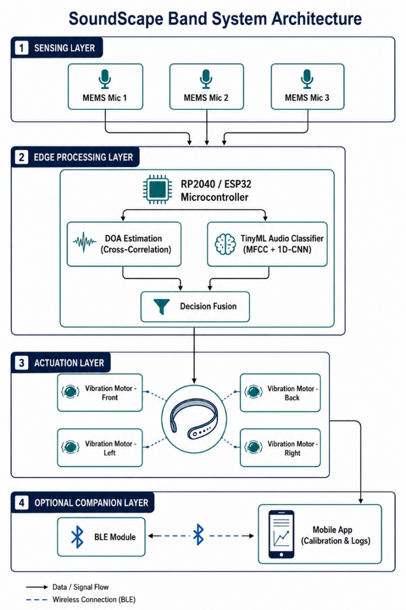
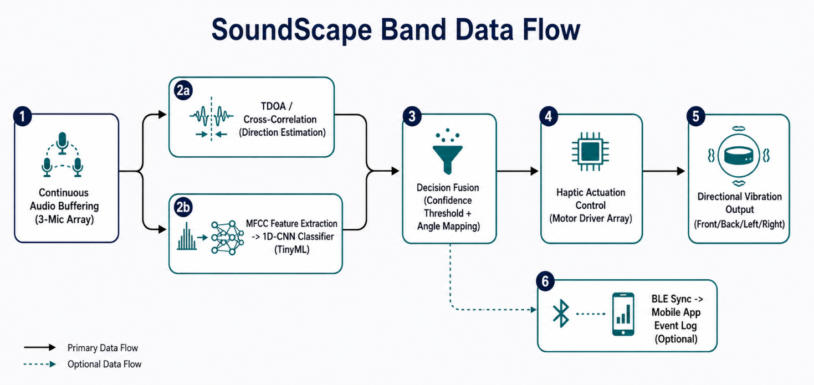
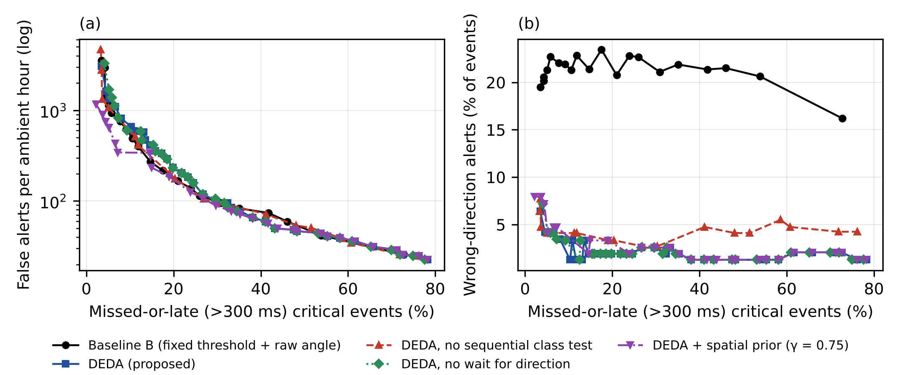
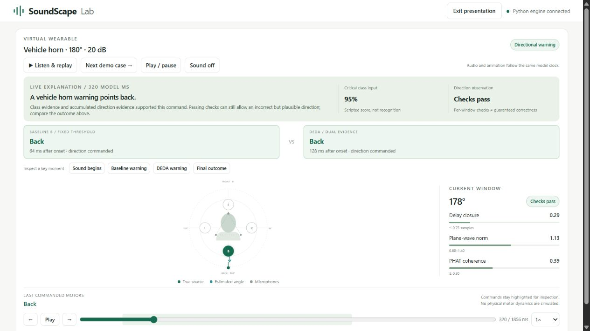
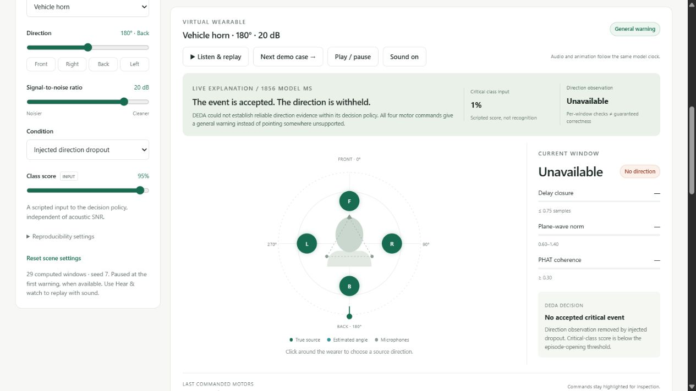
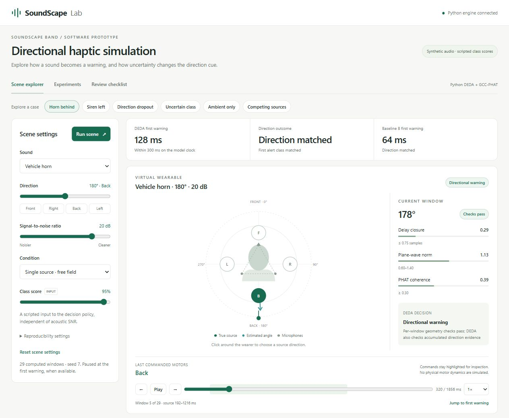
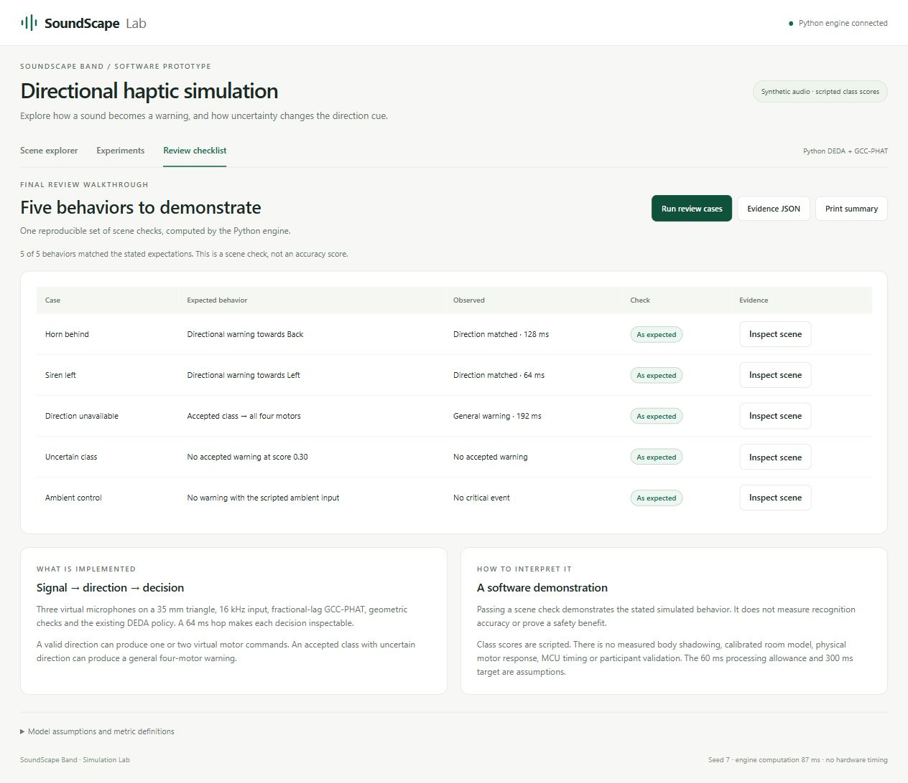
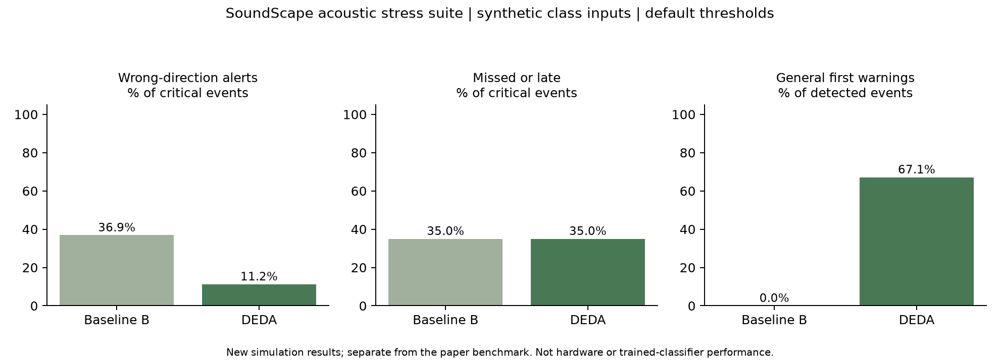
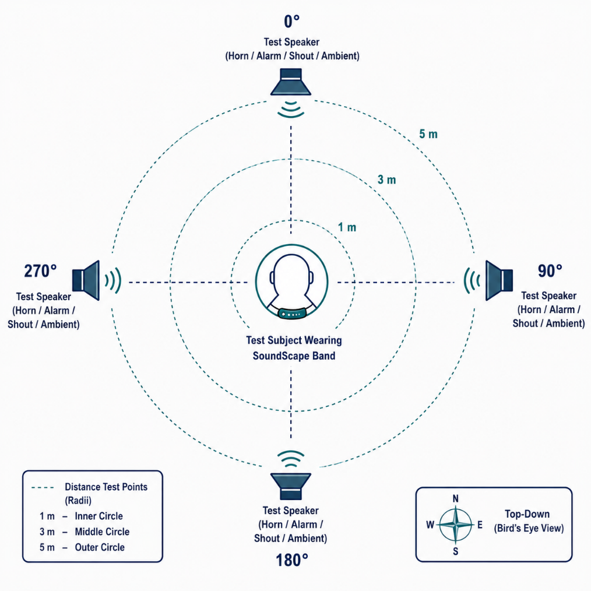

# SoundScape Band

**A simulation study of reliability-aware directional haptic alert decisions for Deaf and hard-of-hearing users.**

SoundScape Band investigates DEDA (Dual-Evidence Deadline Alerting), a policy that accepts sound-class evidence separately from direction evidence. The current submission consists of a synthetic numerical study, an audible Python-backed browser simulation and a Wokwi virtual ESP32 policy replay. A three-microphone neckband with four vibration motors is the proposed hardware concept; no physical wearable or recorded wearable validation is submitted.

## Open the live simulation

**[Launch SoundScape Lab](https://soundscape-simulation.vercel.app)** in a modern browser. No installation or local Python server is needed for this hosted version. Click Hear & watch, then Presentation mode. The Python engine runs on Vercel; hosted experiments return results when complete rather than using the local background-job controls. [Deployment details](deployment/README.md).

## Latest submission

- [Final Word report — 15 pages](docs/submission/SoundScape_Final_Report_Updated.docx)
- [Final Word research paper — 5 pages](docs/submission/SoundScape_Final_Research_Paper_Updated.docx)
- [Wokwi kit and upload instructions](wokwi/README.md)
- [Expanded synthetic dataset and reproduction details](results/final_simulation_study/README.md)


## The idea in one paragraph

DEDA can accept an important sound event while withholding an uncertain direction. It combines empirical class evidence, a bounded decision episode and accumulated direction evidence filtered by closure, plane-wave norm and PHAT coherence checks. Accepted class evidence can produce a directional command or a general four-output warning. Passing these checks does not guarantee a correct direction. The 300 ms setting is a simulation reference target, not a guaranteed physical onset-to-vibration deadline. Waiting, rejection and class uncertainty can produce missed or late warnings.

<details>
<summary><strong>Proposed wearable architecture and signal flow</strong></summary>



*Hardware design concept. The Android prototype currently uses the phone microphone and vibration motor; the BLE wearable connection shown here is proposed.*



*The simulator supplies synthetic class inputs to the existing direction and DEDA code. The Android app runs pretrained YAMNet with a separate phone alert policy.*

</details>

## Status

### Android real-audio prototype

[`android/`](android/README.md) contains **SoundScape Lab**, an installable offline Android companion for live microphone classification, phone vibration, and CSV test logs. It uses pretrained YAMNet with a separate persistence gate. It does not validate the wearable's microphone geometry, directional DEDA, four motors, or 300 ms deadline. See its README for installation, build instructions, and the real-audio evaluation protocol.

| Component | Synthetic data | Recorded audio | On RP2040 / ESP32 |
|---|---|---|---|
| DEDA decision policy (Python + C) | Tested | Not evaluated | Prepared-input C replay in Wokwi; no physical board evaluation |
| GCC-PHAT fractional-lag grid + reliability checks | ✅ tested (free field) | ⏳ not yet | ⏳ not yet |
| C core matches Python reference | Host equivalence checks; five replay cases match Python | — | ESP32 replay sketch compiled; full audio pipeline untested |
| `evaluate_logs.py` (real-data comparison) | ✅ smoke-tested | ⏳ waiting for recordings | — |
| Firmware integration | — | — | ⏳ see [`firmware/`](firmware/) |

> **All results below come from simulation.** They check that the logic behaves as designed; they are not evidence of real-world performance. The recorded-data protocol is in [`docs/experiment_protocol.md`](docs/experiment_protocol.md).

## Expanded study results

The latest study uses **100 synthetic streams, 3,594 events**, separate stress/deadline sets, and **4,200 acoustic scenes** with paired bin-selection estimates. Rates below are mean per-stream rates; class scores and localization error distributions are generated assumptions.

| Policy | Wrong-direction events % [95% CI] | Missed or late >300 ms % | General warnings % of detections | False alerts / ambient hour |
|---|---|---|---|---|
| Baseline B | 20.31 [18.98, 21.62] | 10.2 | 1.4 | 306.4 |
| DEDA | 2.45 [1.93, 3.01] | 15.3 | 14.1 | 286.8 |

Fewer misleading spatial commands come with additional missed-or-late events and reduced directional specificity. The false-alert burden remains high. Simpler immediate-fallback and no-direction-wait variants remain strong alternatives. These are synthetic policy outcomes, not measured recognition accuracy or wearable safety benefits. See the [dataset protocol](results/final_simulation_study/README.md) and final documents for ablations, confidence intervals, error definitions and adverse findings.

<details>
<summary>Historical four-seed results and figures</summary>

### Original decision-stream study

Synthetic decision-level streams, 4 seeds × 20 min, operating points chosen on separate calibration streams (mean ± SD):

| Policy | Wrong-direction alerts (% of events) | Missed or late >300 ms (%) | Non-directional alerts (%) |
|---|---|---|---|
| B: fixed threshold + raw angle (original design) | 23.5 ± 4.3 | 15.8 ± 7.2 | 1.3 ± 1.5 |
| **DEDA** | **2.7 ± 2.1** | 17.3 ± 2.5 | 8.7 ± 9.7 |

Free-field direction front end, harmonic horn-like source at 0 dB SNR, 16 kHz: correct quadrant **64 % → 93 %** when GCC-PHAT uses only the strongest 25 % of bins.

The original study did not find a benefit from sequential confirmation at its operating point; the expanded ablations report its timing and false-alert trade-offs separately. Full tables: [`results/`](results/) · trade-off curves: [`docs/figures/synthetic_tradeoff.png`](docs/figures/synthetic_tradeoff.png).



*Original decision-stream benchmark and ablations. These curves describe simulation performance, not measurements from a physical wearable or the Android app.*


</details>

## Repository layout

```
python/deda/        reference implementation: policy.py (DEDA + baselines), doa.py (GCC-PHAT, checks), metrics.py, synth.py
python/tests/       policy, acoustic, service and Python-vs-C checks
python/*.py         run_synthetic.py, acoustic_checks.py, evaluate_logs.py, make_demo_logs.py
c/                  embedded C99 core: deda.c/.h (decision policy), doa_gcc.c (GCC grid, direction maths), host test driver
firmware/           MCU integration notes and example
hardware/           bill of materials and wiring
docs/               final Word submissions, teaching guide, protocol, screenshots
wokwi/              virtual ESP32 policy replay with OLED, buttons and LEDs
results/            outputs behind the numbers in the paper
data/               log format for future recorded trials; no wearable recordings supplied
```

## Quick start

### Interactive simulation without hardware

The browser lab now connects simulated three-microphone signals to the **existing Python GCC-PHAT and DEDA implementations**, with virtual motors, replay, reliability checks, baseline comparison, and JSON/CSV exports. Sound-class probabilities remain explicitly simulated; no trained classifier or physical motor response is claimed.

```powershell
python -m pip install -r requirements.txt
python python/simulator_server.py
```

Open **http://127.0.0.1:8765**. To use the review-session port, run `python python/simulator_server.py --port 8766` and open **http://127.0.0.1:8766**. These addresses are for the local version; the public Vercel link above works without the laptop server. On Windows, `Start-Simulator.cmd` also starts the server after dependencies are installed. The app runs locally without internet after setup.

The scene explorer offers 12 synthetic sound scenarios, including ambulance sirens, truck horns, smoke alarms, dog barking, doorbells, glass breaking and rain. The first three reuse existing alert classes; the other additions are explicitly labelled outside-class controls with no alert expected. [Sound mappings](simulator/README.md#common-environment-sound-library). The study and Wokwi cases retain their existing class definitions.

The workspace includes audible replay of the same synthetic Mic 1 signal, live DEDA explanations, presentation mode, Baseline B versus DEDA commands, class-evidence bars and key-event jumps. Replay speeds are 0.25×, 0.5×, 1× and 2×; changing speed also changes pitch. Run scene recomputes settings and starts replay, respecting the mute switch. Six presets, processing traces, local history and JSON/CSV exports remain available. Experiments report real trial progress and support cancellation. A five-case review checklist generates inspectable evidence and a print-friendly summary.

For the final presentation, start with the **[four-minute review guide](docs/FINAL_REVIEW_GUIDE.md)**. Complete setup, experiments, limitations, and Colab instructions: **[Simulation guide](docs/SIMULATION_GUIDE.md)**.



*Actual browser view: Baseline B warns at 64 model ms and DEDA at 128 model ms in this scene. Audio is synthetic; class scores are scripted.*



*Actual fallback trace. Four highlighted outputs represent a general warning, not physical vibration.*

<details><summary>Earlier interface screenshots</summary>



*Actual scene explorer screenshot. Python computes the direction and policy decisions from synthetic microphone signals; class confidence is a scripted input and motor commands are visualized on screen.*



</details>

```powershell
python python/run_simulator_experiment.py --suite quick --seeds 2
```

This creates new timestamped results under `results/simulation/`, preserving the paper's original results. It is a new acoustic stress suite using frozen default thresholds, **not** a reproduction of the paper's decision-stream benchmark.



*Saved full acoustic stress-suite run: baseline wrong-direction alerts 36.9%, DEDA 11.2%; both missed or late 35.0%. General first warnings account for 67.1% of detected DEDA events. These use synthetic class inputs and default thresholds, so they belong to a separate experiment from the benchmark above.*

### Wokwi virtual device demonstration

Open the two online Wokwi demonstrations:

- [Wokwi simulation 1](https://wokwi.com/projects/479065380305937409)
- [Wokwi simulation 2](https://wokwi.com/projects/479067404737540097)

These are supplementary virtual demonstrations; their input models and baseline configurations may differ. Neither establishes physical wearable performance.

Open the [Wokwi guide](wokwi/README.md), then copy the six files from [wokwi/sketch](wokwi/sketch) into a new ESP32 project. The OLED explains actual C-policy decisions; five buttons select scenarios and LEDs illustrate directional or general output patterns. Prepared observations are replayed through the policy; Wokwi does not listen to sounds or run the full acoustic/classification pipeline. Host checks match the five Python cases. The upgraded replay/display sketch compiles for ESP32, which does not establish physical resource, timing or energy feasibility.

### Reproduce the expanded numerical study

```powershell
python -m pip install -r requirements-study.txt
python python/final_simulation_study.py --workers 4
python python/supplement_simulation_study.py
python python/test_final_study.py
```

Use the fixed versions and seed partitions documented with the [results](results/final_simulation_study/README.md). Browser and Wokwi examples use default demo thresholds; the study uses separately frozen thresholds. Do not pool their outcomes.

### Original research scripts

Requires Python ≥ 3.10, a C compiler and `make`.

```bash
git clone https://github.com/rizzit17/soundscape-band.git
cd soundscape-band
pip install -r requirements.txt

cd c && make && cd ..            # host builds of the C core (float and double)
cd python
python -m pytest -q tests        # 31 tests
python acoustic_checks.py        # free-field direction front-end checks (~10 s)
python run_synthetic.py          # policy comparison + ablations (~5 min) -> ../results/
```

### Evaluating on recorded trials

1. Log one row per analysis window from the band (CNN logits + TDOA outputs) in the format in [`data/README.md`](data/README.md).
2. Split recordings by **session and source clip** into `calib` and `test`.
3. Run:

```bash
python evaluate_logs.py windows.csv events.csv --target-miss 0.05 --out results.json
```

This fits the temperature, selects thresholds on the calibration split only, and reports baselines A, B and DEDA on the test split with session-level bootstrap confidence intervals. Try it on demo data with `python make_demo_logs.py` first.

## Using the C core

```c
#include "deda.h"

deda_config_t cfg; deda_default_config(&cfg);   /* replace thresholds with calibrated values */
deda_state_t st;   deda_init(&st, &cfg);

/* once per analysis hop, after the DOA and CNN branches finish */
deda_alert_t out[DEDA_MAX_ALERTS_PER_STEP];
int n = deda_step(&st, &window, out);
for (int i = 0; i < n; i++) haptics_play(out[i].motors, out[i].cls, out[i].kind);
```

No dynamic allocation, no recursion, constant work per window. Decision state: 312 bytes (host measurement, float build).

## Hardware

3 × INMP441 I²S MEMS microphones (≈35 mm triangle), RP2040 or ESP32, 4 × coin vibration motors with transistor drivers, 3.7 V 500 mAh Li-ion + TP4056. See [`hardware/BOM.md`](hardware/BOM.md) and [`hardware/wiring.md`](hardware/wiring.md). **All three microphones must share the same I²S bit and word clocks**; an unsynchronised microphone corrupts every TDOA.

<details>
<summary><strong>Planned physical evaluation setup</strong></summary>



*Proposed hardware test protocol, not a photograph or evidence of completed physical testing. The phone prototype currently evaluates sound recognition and general vibration without source-angle validation.*

</details>

## Team

Rishit Chaudhary (23BCT0157) · Siddharth Verma (23BCT0159) · Deeksha V (23BCT0221)
B.Tech CSE (IoT), Vellore Institute of Technology, Vellore · Faculty supervisor: Dr. Jayachandran J

## Citation

If you use this work, please cite it (see [`CITATION.cff`](CITATION.cff)):

> R. Chaudhary, S. Verma, D. V, "Reliability-Aware Directional Haptic Alerting for a Low-Cost Three-Microphone Wearable for Deaf and Hard-of-Hearing Users," manuscript, 2026.

## License

[MIT](LICENSE)
